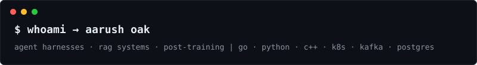

i build agentic systems and the backend infrastructure underneath them—focused on agent harnesses, retrieval pipelines, and low-latency services that hold up in production.

- **previously (ai intern):** owned and built a product's backend and agentic stack. engineered agentic retrieval over postgresql, tool routing, and context management, alongside decoupled background compute to run parallel optimization algorithms without blocking live apis.

### projects

| repo | what it does | stack |
|---|---|---|
| [**heimdall**](https://github.com/prathameshk421/Heimdall) | automated pr verification & merge gate running red-first tests inside rootless podman sandboxes | `go` `podman` `postgresql` |
| [**loadline**](https://github.com/aarush323/LoadLine) | capacity agent that runs `k6` load tests in docker, patches bottlenecks, and opens a pr only if metrics improve | `python` `pydantic ai` `k6` `docker` |
| [**markoblitz**](https://github.com/Namz10/markoblitz) | adversarial payment-fraud simulator & detection pipeline (`0.9985` pr-auc, `0.032%` fpr on time-cut holdout) | `python` `postgresql` |
| [**foresight**](https://github.com/aarush323/Foresight) | multi-agent predictive fleet maintenance & root-cause analysis over real-time telemetry streams | `python` `langgraph` `fastapi` |

  <picture>
    <source media="(prefers-color-scheme: dark)" srcset="https://raw.githubusercontent.com/aarush323/aarush323/cards/summary-dark.svg">
    
  </picture>
  <picture>
    <source media="(prefers-color-scheme: dark)" srcset="https://raw.githubusercontent.com/aarush323/aarush323/cards/languages-dark.svg">
    
  </picture>

  <picture>
    <source media="(prefers-color-scheme: dark)" srcset="https://raw.githubusercontent.com/aarush323/aarush323/cards/contributions-dark.svg">
    
  </picture>
  <picture>
    <source media="(prefers-color-scheme: dark)" srcset="https://raw.githubusercontent.com/aarush323/aarush323/cards/weekly-dark.svg">
    
  </picture>

### stack

- **ai / ml:** `rag systems` · `agent harnesses` · `post-training` · `evals` · `langgraph` · `pydantic ai` · `vector dbs`
- **backend & infra:** `go` · `python` · `c++` · `fastapi` · `postgresql` · `kafka` · `redis` · `docker` · `kubernetes`

### highlights

- **lexsi hackathon (top 10% — top 35 / ~400 teams):** post-trained `tiny-aya-global` (3.35b) for frugal multi-turn sqlite tool-calling (`frugal-analyst`)
- **amazon ml challenge '26 (rank 677 / ~24,000 teams):** fine-tuned entity resolution pipeline (`0.984` f0.5 across 1.7m × 10m multilingual records)
- **barclays hack-o-hire '26:** top 10 national finalist (multi-agent pre-delinquency engine with `langgraph`, `lightgbm/gru`, `kafka`, and `redis` sse)

[linkedin](https://www.linkedin.com/in/aarush-oak/) · [x](https://x.com/mrx123444) · [huggingface](https://huggingface.co/aarush323) · [leetcode](https://leetcode.com/u/wreck323/) · [email](mailto:oakaarush@gmail.com)
