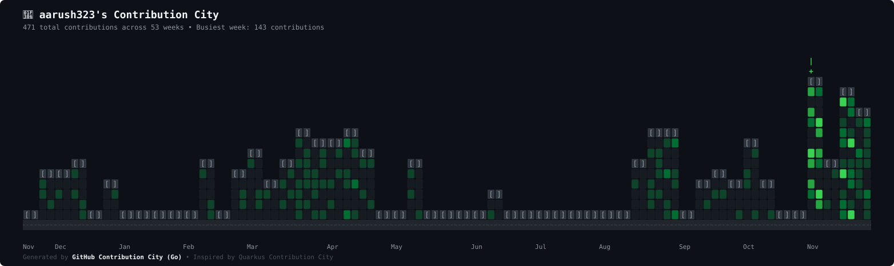

  
  
  
  
  

Building **agentic systems** and the **backend infrastructure** underneath them. Focused on agent harnesses, retrieval pipelines, and low-latency services that hold up in production.

- **Previously (AI Intern):** Owned a product's backend and agentic stack. Built agentic retrieval over PostgreSQL, tool routing, context management, and decoupled background compute for parallel optimization algorithms.

## Projects

| Project | Overview | Stack |
| :--- | :--- | :--- |
| [**Heimdall**](https://github.com/prathameshk421/Heimdall) | Automated PR verification & merge gate running red-first tests in rootless Podman sandboxes | `Go` `Podman` `PostgreSQL` |
| [**LoadLine**](https://github.com/aarush323/LoadLine) | Capacity agent that runs `k6` load tests in Docker, patches bottlenecks, and opens PRs only if metrics improve | `Python` `Pydantic AI` `k6` `Docker` |
| [**HoH**](https://github.com/aarush323/HoH) | Pre-delinquency engine combining a `LightGBM + GRU` ensemble (`SHAP`) with a `LangGraph` compliance/routing chain and HITL voice agent over `Kafka` | `Python` `LangGraph` `Kafka` `PostgreSQL` `Redis` `Cassandra` |
| [**Foresight**](https://github.com/aarush323/Foresight) | Multi-agent predictive fleet maintenance & root-cause analysis over real-time telemetry | `Python` `LangGraph` `FastAPI` |

## Achievements

| Competition | Result | Work |
| :--- | :--- | :--- |
| **Lexsi Hackathon** | **Top 10%** (Top 35 / ~400) | Post-trained `tiny-aya-global` (3.35B) for frugal multi-turn SQLite tool-calling (`frugal-analyst`) |
| **Amazon ML Challenge '26** | **Rank 677** / ~24,000 | Fine-tuned multilingual entity resolution pipeline (**0.984 F0.5** across 1.7M × 10M records) |
| **Barclays Hack-O-Hire '26** | **Top 10 National Finalist** | Built [**HoH**](https://github.com/aarush323/HoH), a streaming pre-delinquency intervention engine with compliance hard-stops and a voice agent |

## Stack

- **AI / ML:** `RAG Systems` · `Agent Harnesses` · `Post-Training` · `Evals` · `LangGraph` · `Pydantic AI` · `Vector DBs`
- **Backend & Infra:** `Go` · `Python` · `C++` · `FastAPI` · `PostgreSQL` · `Kafka` · `Redis` · `Docker` · `Kubernetes`

---

